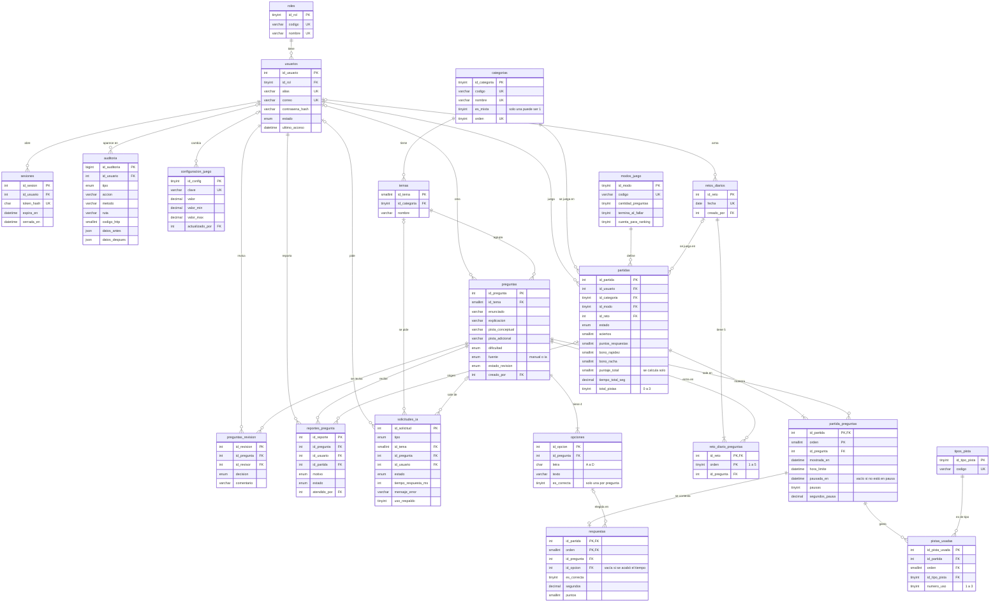

# Diagrama de la base de datos de RetoTrivia UTH

Son 20 tablas. Los rankings, récords y estadísticas no aparecen porque son vistas que se sacan de `partidas` y `respuestas`.

Para verlo: GitHub lo dibuja solo, y en VS Code se ve con la extensión "Markdown Preview Mermaid Support".

## Vistas

| Vista | Sale de |
|---|---|
| `v_preguntas_publicas` | preguntas, temas, categorias |
| `v_opciones_publicas` | opciones, preguntas |
| `v_records_categoria` | partidas, modos_juego |
| `v_ranking_categoria` | v_records_categoria, categorias, usuarios |
| `v_ranking_principal` | v_records_categoria, categorias, usuarios |
| `v_ranking_mixta` | v_records_categoria, categorias, usuarios |
| `v_ranking_reto_diario` | partidas, retos_diarios, usuarios |
| `v_estadisticas_usuario` | usuarios, partidas, respuestas |
| `v_estadisticas_usuario_categoria` | respuestas, partidas, preguntas, temas, v_records_categoria |
| `v_ultimas_partidas` | partidas, categorias, modos_juego |
